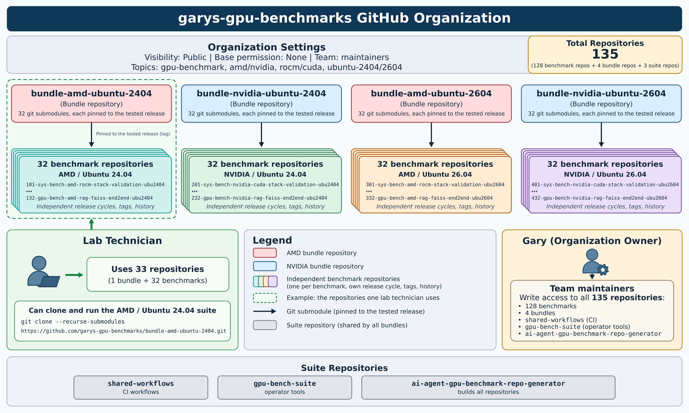
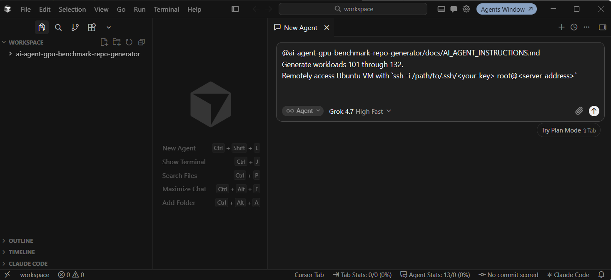

# GPU Benchmark & Platform Validation Workloads
### *Run one test, run all 32, or generate your own — for AMD and NVIDIA GPUs*

### **This page:** [github.com/GaryMichaelBass/GaryMichaelBass](https://github.com/GaryMichaelBass/GaryMichaelBass)

---

## CHAPTER ONE: Tour the Architecture

- A standardized collection of 32 hardware, compute, and AI inference validation workloads.
- Supports ROCm and CUDA under Ubuntu 24.04 LTS and 26.04 LTS.
- Four platform bundles (AMD/24.04, AMD/26.04, NVIDIA/24.04, NVIDIA/26.04) yielding 128 workload repositories.
- Downloadable individually or as 32-workload bundles.

---

### Four Platform Bundles

| Suite                       | GPU Platform   | Operating System | Workload Numbers   | Repos |
|-----------------------------|----------------|------------------|----------------|------:|
| **AMD / Ubuntu 24.04**      | AMD ROCm     | Ubuntu 24.04     | 101–132        |    32 |
| **NVIDIA / Ubuntu 24.04**   | NVIDIA CUDA  | Ubuntu 24.04     | 201–232        |    32 |
| **AMD / Ubuntu 26.04**      | AMD ROCm     | Ubuntu 26.04     | 301–332        |    32 |
| **NVIDIA / Ubuntu 26.04**   | NVIDIA CUDA  | Ubuntu 26.04     | 401–432        |    32 |

**128 total repositories** (32 unique workloads × 4 platforms)

---

<a href="images/github-organization.png">
  
</a>

---
## 📊 Workload Repository Matrix

| Workload Description | AMD&nbsp;/&nbsp;24.04 | NVIDIA&nbsp;/&nbsp;24.04 | AMD&nbsp;/&nbsp;26.04 | NVIDIA&nbsp;/&nbsp;26.04 |
| :--- | :---: | :---: | :---: | :---: |
| **System&nbsp;Config&nbsp;Verification** | [101](https://github.com/garys-gpu-benchmarks/101-sys-bench-amd-rocm-stack-validation-ubu2404) | [201](https://github.com/garys-gpu-benchmarks/201-sys-bench-nvidia-cuda-stack-validation-ubu2404) | [301](https://github.com/garys-gpu-benchmarks/301-sys-bench-amd-rocm-stack-validation-ubu2604) | [401](https://github.com/garys-gpu-benchmarks/401-sys-bench-nvidia-cuda-stack-validation-ubu2604) |
| **System&nbsp;Validation&nbsp;(Clocks,&nbsp;Temp,&nbsp;Health)** | [102](https://github.com/garys-gpu-benchmarks/102-sys-bench-amd-rocm-health-validation-ubu2404) | [202](https://github.com/garys-gpu-benchmarks/202-sys-bench-nvidia-gpu-health-validation-ubu2404) | [302](https://github.com/garys-gpu-benchmarks/302-sys-bench-amd-rocm-health-validation-ubu2604) | [402](https://github.com/garys-gpu-benchmarks/402-sys-bench-nvidia-gpu-health-validation-ubu2604) |
| **CPU&nbsp;+&nbsp;System&nbsp;Stress&nbsp;Stability** | [103](https://github.com/garys-gpu-benchmarks/103-sys-bench-amd-system-stress-stability-ubu2404) | [203](https://github.com/garys-gpu-benchmarks/203-sys-bench-nvidia-system-stress-stability-ubu2404) | [303](https://github.com/garys-gpu-benchmarks/303-sys-bench-amd-system-stress-stability-ubu2604) | [403](https://github.com/garys-gpu-benchmarks/403-sys-bench-nvidia-system-stress-stability-ubu2604) |
| **Silent&nbsp;Data&nbsp;Corruption&nbsp;(SDC&nbsp;/&nbsp;ECC)** | [104](https://github.com/garys-gpu-benchmarks/104-gpu-bench-amd-sdc-ecc-integrity-ubu2404) | [204](https://github.com/garys-gpu-benchmarks/204-gpu-bench-nvidia-sdc-ecc-integrity-ubu2404) | [304](https://github.com/garys-gpu-benchmarks/304-gpu-bench-amd-sdc-ecc-integrity-ubu2604) | [404](https://github.com/garys-gpu-benchmarks/404-gpu-bench-nvidia-sdc-ecc-integrity-ubu2604) |
| **PyTorch&nbsp;Tensor&nbsp;Op&nbsp;Correctness&nbsp;Suite** | [105](https://github.com/garys-gpu-benchmarks/105-gpu-bench-amd-pytorch-tensor-correctness-ubu2404) | [205](https://github.com/garys-gpu-benchmarks/205-gpu-bench-nvidia-pytorch-tensor-correctness-ubu2404) | [305](https://github.com/garys-gpu-benchmarks/305-gpu-bench-amd-pytorch-tensor-correctness-ubu2604) | [405](https://github.com/garys-gpu-benchmarks/405-gpu-bench-nvidia-pytorch-tensor-correctness-ubu2604) |
| **FIO&nbsp;NVMe&nbsp;Storage&nbsp;Sweep** | [106](https://github.com/garys-gpu-benchmarks/106-sys-bench-amd-fio-nvme-sweep-ubu2404) | [206](https://github.com/garys-gpu-benchmarks/206-sys-bench-nvidia-fio-nvme-sweep-ubu2404) | [306](https://github.com/garys-gpu-benchmarks/306-sys-bench-amd-fio-nvme-sweep-ubu2604) | [406](https://github.com/garys-gpu-benchmarks/406-sys-bench-nvidia-fio-nvme-sweep-ubu2604) |
| **STREAM&nbsp;CPU&nbsp;DDR5&nbsp;Bandwidth** | [107](https://github.com/garys-gpu-benchmarks/107-sys-bench-amd-stream-ddr5-bandwidth-ubu2404) | [207](https://github.com/garys-gpu-benchmarks/207-sys-bench-nvidia-stream-ddr5-bandwidth-ubu2404) | [307](https://github.com/garys-gpu-benchmarks/307-sys-bench-amd-stream-ddr5-bandwidth-ubu2604) | [407](https://github.com/garys-gpu-benchmarks/407-sys-bench-nvidia-stream-ddr5-bandwidth-ubu2604) |
| **iPerf3&nbsp;Network&nbsp;Performance&nbsp;Sweep** | [108](https://github.com/garys-gpu-benchmarks/108-sys-bench-amd-iperf3-network-performance-ubu2404) | [208](https://github.com/garys-gpu-benchmarks/208-sys-bench-nvidia-iperf3-network-performance-ubu2404) | [308](https://github.com/garys-gpu-benchmarks/308-sys-bench-amd-iperf3-network-performance-ubu2604) | [408](https://github.com/garys-gpu-benchmarks/408-sys-bench-nvidia-iperf3-network-performance-ubu2604) |
| **multichase&nbsp;NUMA&nbsp;Latency&nbsp;(Pointer&#8209;Chase)** | [109](https://github.com/garys-gpu-benchmarks/109-sys-bench-amd-multichase-numa-latency-ubu2404) | [209](https://github.com/garys-gpu-benchmarks/209-sys-bench-nvidia-multichase-numa-latency-ubu2404) | [309](https://github.com/garys-gpu-benchmarks/309-sys-bench-amd-multichase-numa-latency-ubu2604) | [409](https://github.com/garys-gpu-benchmarks/409-sys-bench-nvidia-multichase-numa-latency-ubu2604) |
| **NUMA&nbsp;Cache&nbsp;Latency&nbsp;Sweep** | [110](https://github.com/garys-gpu-benchmarks/110-sys-bench-amd-numa-cache-performance-ubu2404) | [210](https://github.com/garys-gpu-benchmarks/210-sys-bench-nvidia-numa-cache-performance-ubu2404) | [310](https://github.com/garys-gpu-benchmarks/310-sys-bench-amd-numa-cache-performance-ubu2604) | [410](https://github.com/garys-gpu-benchmarks/410-sys-bench-nvidia-numa-cache-performance-ubu2604) |
| **Linux&nbsp;perf&nbsp;PMU&nbsp;Analysis&nbsp;Harness** | [111](https://github.com/garys-gpu-benchmarks/111-sys-bench-amd-linux-perf-pmu-ubu2404) | [211](https://github.com/garys-gpu-benchmarks/211-sys-bench-nvidia-linux-perf-pmu-ubu2404) | [311](https://github.com/garys-gpu-benchmarks/311-sys-bench-amd-linux-perf-pmu-ubu2604) | [411](https://github.com/garys-gpu-benchmarks/411-sys-bench-nvidia-linux-perf-pmu-ubu2604) |
| **lmbench&nbsp;OS&nbsp;Microbench&nbsp;Suite** | [112](https://github.com/garys-gpu-benchmarks/112-sys-bench-amd-lmbench-microbench-suite-ubu2404) | [212](https://github.com/garys-gpu-benchmarks/212-sys-bench-nvidia-lmbench-microbench-suite-ubu2404) | [312](https://github.com/garys-gpu-benchmarks/312-sys-bench-amd-lmbench-microbench-suite-ubu2604) | [412](https://github.com/garys-gpu-benchmarks/412-sys-bench-nvidia-lmbench-microbench-suite-ubu2604) |
| **GUPS&nbsp;Random&nbsp;Memory&nbsp;Access** | [113](https://github.com/garys-gpu-benchmarks/113-sys-bench-amd-gups-random-memory-ubu2404) | [213](https://github.com/garys-gpu-benchmarks/213-sys-bench-nvidia-gups-random-memory-ubu2404) | [313](https://github.com/garys-gpu-benchmarks/313-sys-bench-amd-gups-random-memory-ubu2604) | [413](https://github.com/garys-gpu-benchmarks/413-sys-bench-nvidia-gups-random-memory-ubu2604) |
| **Host/Device&nbsp;Memcpy&nbsp;(H2D,&nbsp;D2H,&nbsp;D2D)** | [114](https://github.com/garys-gpu-benchmarks/114-gpu-bench-amd-hipmemcpy-transfer-bandwidth-ubu2404) | [214](https://github.com/garys-gpu-benchmarks/214-gpu-bench-nvidia-memcpy-transfer-bandwidth-ubu2404) | [314](https://github.com/garys-gpu-benchmarks/314-gpu-bench-amd-hipmemcpy-transfer-bandwidth-ubu2604) | [414](https://github.com/garys-gpu-benchmarks/414-gpu-bench-nvidia-memcpy-transfer-bandwidth-ubu2604) |
| **BabelStream&nbsp;HBM&nbsp;Bandwidth** | [115](https://github.com/garys-gpu-benchmarks/115-gpu-bench-amd-babelstream-hbm-bandwidth-ubu2404) | [215](https://github.com/garys-gpu-benchmarks/215-gpu-bench-nvidia-babelstream-hbm-bandwidth-ubu2404) | [315](https://github.com/garys-gpu-benchmarks/315-gpu-bench-amd-babelstream-hbm-bandwidth-ubu2604) | [415](https://github.com/garys-gpu-benchmarks/415-gpu-bench-nvidia-babelstream-hbm-bandwidth-ubu2604) |
| **Collective&nbsp;Fabric&nbsp;Bandwidth&nbsp;(RCCL&nbsp;/&nbsp;NCCL)** | [116](https://github.com/garys-gpu-benchmarks/116-gpu-bench-amd-rccl-bandwidth-test-ubu2404) | [216](https://github.com/garys-gpu-benchmarks/216-gpu-bench-nvidia-nccl-bandwidth-test-ubu2404) | [316](https://github.com/garys-gpu-benchmarks/316-gpu-bench-amd-rccl-bandwidth-test-ubu2604) | [416](https://github.com/garys-gpu-benchmarks/416-gpu-bench-nvidia-nccl-bandwidth-test-ubu2604) |
| **GEMM&nbsp;Microbenchmark&nbsp;(rocBLAS/cuBLAS)** | [117](https://github.com/garys-gpu-benchmarks/117-gpu-bench-amd-gemm-rocblas-micro-ubu2404) | [217](https://github.com/garys-gpu-benchmarks/217-gpu-bench-nvidia-gemm-cublas-micro-ubu2404) | [317](https://github.com/garys-gpu-benchmarks/317-gpu-bench-amd-gemm-rocblas-micro-ubu2604) | [417](https://github.com/garys-gpu-benchmarks/417-gpu-bench-nvidia-gemm-cublas-micro-ubu2604) |
| **Convolution&nbsp;Solver&nbsp;(MIOpen&nbsp;/&nbsp;cuDNN)** | [118](https://github.com/garys-gpu-benchmarks/118-gpu-bench-amd-miopen-convolution-micro-ubu2404) | [218](https://github.com/garys-gpu-benchmarks/218-gpu-bench-nvidia-cudnn-convolution-micro-ubu2404) | [318](https://github.com/garys-gpu-benchmarks/318-gpu-bench-amd-miopen-convolution-micro-ubu2604) | [418](https://github.com/garys-gpu-benchmarks/418-gpu-bench-nvidia-cudnn-convolution-micro-ubu2604) |
| **PyTorch&nbsp;/&nbsp;TorchBench&nbsp;Microkernel&nbsp;Suite** | [119](https://github.com/garys-gpu-benchmarks/119-gpu-bench-amd-torch-micro-suite-ubu2404) | [219](https://github.com/garys-gpu-benchmarks/219-gpu-bench-nvidia-torch-micro-suite-ubu2404) | [319](https://github.com/garys-gpu-benchmarks/319-gpu-bench-amd-torch-micro-suite-ubu2604) | [419](https://github.com/garys-gpu-benchmarks/419-gpu-bench-nvidia-torch-micro-suite-ubu2604) |
| **High&nbsp;Performance&nbsp;Linpack&nbsp;(HPL&nbsp;FP64)** | [120](https://github.com/garys-gpu-benchmarks/120-gpu-bench-amd-linpack-rochpl-fp64-ubu2404) | [220](https://github.com/garys-gpu-benchmarks/220-gpu-bench-nvidia-linpack-hpl-fp64-ubu2404) | [320](https://github.com/garys-gpu-benchmarks/320-gpu-bench-amd-linpack-rochpl-fp64-ubu2604) | [420](https://github.com/garys-gpu-benchmarks/420-gpu-bench-nvidia-linpack-hpl-fp64-ubu2604) |
| **ResNet&#8209;50&nbsp;FP16&nbsp;Training&nbsp;Step** | [121](https://github.com/garys-gpu-benchmarks/121-gpu-bench-amd-resnet50-pytorch-training-ubu2404) | [221](https://github.com/garys-gpu-benchmarks/221-gpu-bench-nvidia-resnet50-pytorch-training-ubu2404) | [321](https://github.com/garys-gpu-benchmarks/321-gpu-bench-amd-resnet50-pytorch-training-ubu2604) | [421](https://github.com/garys-gpu-benchmarks/421-gpu-bench-nvidia-resnet50-pytorch-training-ubu2604) |
| **ResNet&#8209;50&nbsp;BF16&nbsp;Inference&nbsp;Throughput** | [122](https://github.com/garys-gpu-benchmarks/122-gpu-bench-amd-resnet50-pytorch-inference-ubu2404) | [222](https://github.com/garys-gpu-benchmarks/222-gpu-bench-nvidia-resnet50-pytorch-inference-ubu2404) | [322](https://github.com/garys-gpu-benchmarks/322-gpu-bench-amd-resnet50-pytorch-inference-ubu2604) | [422](https://github.com/garys-gpu-benchmarks/422-gpu-bench-nvidia-resnet50-pytorch-inference-ubu2604) |
| **BERT&nbsp;Base&nbsp;Inference&nbsp;Sweep** | [123](https://github.com/garys-gpu-benchmarks/123-gpu-bench-amd-bert-base-inference-ubu2404) | [223](https://github.com/garys-gpu-benchmarks/223-gpu-bench-nvidia-bert-base-inference-ubu2404) | [323](https://github.com/garys-gpu-benchmarks/323-gpu-bench-amd-bert-base-inference-ubu2604) | [423](https://github.com/garys-gpu-benchmarks/423-gpu-bench-nvidia-bert-base-inference-ubu2604) |
| **Stable&nbsp;Diffusion&nbsp;XL&nbsp;Latency&nbsp;Baseline** | [124](https://github.com/garys-gpu-benchmarks/124-gpu-bench-amd-sdxl-diffusers-latency-ubu2404) | [224](https://github.com/garys-gpu-benchmarks/224-gpu-bench-nvidia-sdxl-diffusers-latency-ubu2404) | [324](https://github.com/garys-gpu-benchmarks/324-gpu-bench-amd-sdxl-diffusers-latency-ubu2604) | [424](https://github.com/garys-gpu-benchmarks/424-gpu-bench-nvidia-sdxl-diffusers-latency-ubu2604) |
| **DistilBERT&nbsp;NLP&nbsp;Classification&nbsp;Baseline** | [125](https://github.com/garys-gpu-benchmarks/125-gpu-bench-amd-distilbert-hf-classification-ubu2404) | [225](https://github.com/garys-gpu-benchmarks/225-gpu-bench-nvidia-distilbert-hf-classification-ubu2404) | [325](https://github.com/garys-gpu-benchmarks/325-gpu-bench-amd-distilbert-hf-classification-ubu2604) | [425](https://github.com/garys-gpu-benchmarks/425-gpu-bench-nvidia-distilbert-hf-classification-ubu2604) |
| **JAX&nbsp;XLA&nbsp;Transformer&nbsp;Forward&nbsp;Pass** | [126](https://github.com/garys-gpu-benchmarks/126-gpu-bench-amd-jax-xla-forwardpass-ubu2404) | [226](https://github.com/garys-gpu-benchmarks/226-gpu-bench-nvidia-jax-xla-forwardpass-ubu2404) | [326](https://github.com/garys-gpu-benchmarks/326-gpu-bench-amd-jax-xla-forwardpass-ubu2604) | [426](https://github.com/garys-gpu-benchmarks/426-gpu-bench-nvidia-jax-xla-forwardpass-ubu2604) |
| **vLLM&nbsp;KV&nbsp;Cache&nbsp;Stress&nbsp;Test** | [127](https://github.com/garys-gpu-benchmarks/127-gpu-bench-amd-vllm-kvcache-stress-ubu2404) | [227](https://github.com/garys-gpu-benchmarks/227-gpu-bench-nvidia-vllm-kvcache-stress-ubu2404) | [327](https://github.com/garys-gpu-benchmarks/327-gpu-bench-amd-vllm-kvcache-stress-ubu2604) | [427](https://github.com/garys-gpu-benchmarks/427-gpu-bench-nvidia-vllm-kvcache-stress-ubu2604) |
| **vLLM&nbsp;Throughput&nbsp;&amp;&nbsp;Latency&nbsp;Sweep** | [128](https://github.com/garys-gpu-benchmarks/128-gpu-bench-amd-vllm-throughput-latency-ubu2404) | [228](https://github.com/garys-gpu-benchmarks/228-gpu-bench-nvidia-vllm-throughput-latency-ubu2404) | [328](https://github.com/garys-gpu-benchmarks/328-gpu-bench-amd-vllm-throughput-latency-ubu2604) | [428](https://github.com/garys-gpu-benchmarks/428-gpu-bench-nvidia-vllm-throughput-latency-ubu2604) |
| **vLLM&nbsp;Mistral&nbsp;Token&nbsp;Generation** | [129](https://github.com/garys-gpu-benchmarks/129-gpu-bench-amd-vllm-mistral-rocm-ubu2404) | [229](https://github.com/garys-gpu-benchmarks/229-gpu-bench-nvidia-vllm-mistral-cuda-ubu2404) | [329](https://github.com/garys-gpu-benchmarks/329-gpu-bench-amd-vllm-mistral-rocm-ubu2604) | [429](https://github.com/garys-gpu-benchmarks/429-gpu-bench-nvidia-vllm-mistral-cuda-ubu2604) |
| **SGLang&nbsp;Prompt&#8209;Response&nbsp;Benchmark** | [130](https://github.com/garys-gpu-benchmarks/130-gpu-bench-amd-sglang-prompt-response-ubu2404) | [230](https://github.com/garys-gpu-benchmarks/230-gpu-bench-nvidia-sglang-prompt-response-ubu2404) | [330](https://github.com/garys-gpu-benchmarks/330-gpu-bench-amd-sglang-prompt-response-ubu2604) | [430](https://github.com/garys-gpu-benchmarks/430-gpu-bench-nvidia-sglang-prompt-response-ubu2604) |
| **SGLang&nbsp;Serving&nbsp;Latency&nbsp;Benchmark** | [131](https://github.com/garys-gpu-benchmarks/131-gpu-bench-amd-sglang-serving-latency-ubu2404) | [231](https://github.com/garys-gpu-benchmarks/231-gpu-bench-nvidia-sglang-serving-latency-ubu2404) | [331](https://github.com/garys-gpu-benchmarks/331-gpu-bench-amd-sglang-serving-latency-ubu2604) | [431](https://github.com/garys-gpu-benchmarks/431-gpu-bench-nvidia-sglang-serving-latency-ubu2604) |
| **End&#8209;to&#8209;End&nbsp;FAISS&nbsp;RAG&nbsp;Pipeline** | [132](https://github.com/garys-gpu-benchmarks/132-gpu-bench-amd-rag-faiss-end2end-ubu2404) | [232](https://github.com/garys-gpu-benchmarks/232-gpu-bench-nvidia-rag-faiss-end2end-ubu2404) | [332](https://github.com/garys-gpu-benchmarks/332-gpu-bench-amd-rag-faiss-end2end-ubu2604) | [432](https://github.com/garys-gpu-benchmarks/432-gpu-bench-nvidia-rag-faiss-end2end-ubu2604) |

---
### Execution Mode

| Profile | Typical Runtime | Purpose |
|---|---:|---|
| **Smoke** | ≤ 1 minute | Checks the install and that the workload runs (default). The first run also installs, so it takes longer |
| **Baseline** | 3–5 minutes | Standard benchmark execution |
| **Extended** | 8–15 minutes | Longer performance characterization |

---
### Benchmark Spec Definitions (Master Blueprint for Every Repository)

[Download BenchmarkSpecDefinitions.xlsx](https://github.com/garymichaelbass/garymichaelbass/raw/refs/heads/main/BenchmarkSpecDefinitions.xlsx)

Download and open the Excel workbook to review workload definitions,
validation objectives, metrics, and execution parameters.

---
### Benchmark Categories

The workload suites cover seven primary areas:

- **Memory, Bandwidth & Data Movement** — HBM, fabric, host/device transfers, cache, and bandwidth stress
- **AI Training & Inference** — CNN, Transformer, diffusion, and JAX model training and inference
- **Compute & Math Kernels** — BLAS, LINPACK, microbenchmarks, and mathematical compute kernels
- **LLM Inference & Serving** — vLLM throughput and latency, KV cache, token generation, and SGLang serving
- **System Validation & Reliability** — correctness testing and hardware/software health validation
- **System Profiling & Performance Analysis** — telemetry, counters, and timing characterization
- **End-to-End Application Pipelines** — full-stack application paths such as FAISS-based RAG

---
### System Requirements

- **OS:** a server running Ubuntu 24.04 LTS or 26.04 LTS, with root or sudo access
- **AMD:** one MI300X GPU (gfx942); `run_setup.sh` installs ROCm (10.1.0)
- **NVIDIA:** one H100 GPU (sm_90); `run_setup.sh` installs CUDA (13.3)
- **Host:** 20+ vCPUs, 128+ GB RAM, and about 500 GB of local disk
- **Network:** Internet access for packages and model downloads (1 Gbit/s recommended; 250 Mbit/s minimum)

No server? See [Getting started on AMD Developer Cloud](https://github.com/garys-gpu-benchmarks/ai-agent-gpu-benchmark-repo-generator/blob/main/docs/amd-developer-cloud-getting-started.md) or [Getting started on Runpod](https://github.com/garys-gpu-benchmarks/ai-agent-gpu-benchmark-repo-generator/blob/main/docs/runpod-getting-started.md).

---
### Repository Layout & Execution Model

Every one of the 128 repositories follows the same structure, Once you have run, you know how to run all of them.

```text
<NNN>-<repo>/
├── README.md             # how to run this workload, its metrics and parameters
├── SPEC.md               # the workload specification
├── RESULTS_REFERENCE.md  # reference results from the validated run on real GPU hardware
├── run_setup.sh          # installs the ROCm/CUDA + Python stack (run_benchmark.sh calls it on first use)
├── run_benchmark.sh      # bash run_benchmark.sh --smoke|--baseline|--extended
├── show_metrics.sh       # bash show_metrics.sh NNN: this workload's runs from the ledger
├── list_runs.sh          # bash list_runs.sh [--host <server-address>]: every run in the ledger
├── config/               # benchmark_config.yaml, hardware profiles
├── docs/                 # PRD.md, GENERATION_REPORT.md
├── scripts/              # parse_results.py, validate_results.py, ...
├── src/                  # benchmark source, where the workload builds its own code
├── tests/                # tests and fixtures
├── .github/workflows/    # CI workflows
└── results/
    ├── raw/              # one folder per run: logs, metrics, hardware/software inventory
    ├── RESULTS_ACTUAL.md # latest run of each profile, readable
    ├── benchmark.db      # latest run (SQLite)
    └── summary.json      # latest run summary
```

---
### ✅ Chapter One Takeaways

- 32 standardized workloads × 4 platform bundles = 128 repositories
- Run on AMD ROCm or NVIDIA CUDA with Ubuntu 24.04 LTS or 26.04 LTS
- The collection covers system, memory, compute, AI, LLM, and end-to-end tests
- Three run profiles: Smoke (≤ 1 min), Baseline (3–5 min), Extended (8–15 min)
- `BenchmarkSpecDefinitions.xlsx` defines specs, metrics, and execution rules
- Requires one MI300X or H100 server: 20+ vCPUs, 128+ GB RAM, about 500 GB of disk

<br>

---
---
## CHAPTER TWO: Run a Single Test
Download, install, and run an individual benchmark repository (Workload 107 - AMD Ubuntu 24.04):

NOTE: Repository names are formatted as `<workload_number>-<repo_base_name>` (e.g., `107-sys-bench-amd-stream-ddr5-bandwidth-ubu2404`). Find yours in the `Repo Directory Name` column of the file below.

[BenchmarkSpecDefinitions.xlsx](https://github.com/garymichaelbass/garymichaelbass/raw/refs/heads/main/BenchmarkSpecDefinitions.xlsx)

```bash
apt install git -y
mkdir -p /opt/benchmarks && cd /opt/benchmarks
git clone https://github.com/garys-gpu-benchmarks/107-sys-bench-amd-stream-ddr5-bandwidth-ubu2404.git
cd 107-sys-bench-amd-stream-ddr5-bandwidth-ubu2404
bash run_benchmark.sh --help   # Shows help
bash run_benchmark.sh --smoke  # Performs initial setup then runs benchmark (smoke test)
```

Inspect run results:

```bash
ls -a results/raw/*/*                     # List results directory
cat results/raw/*/metrics_summary.txt     # Display metrics stored in file
bash run_benchmark.sh --smoke --repeat 2  # Run the test two more times to generate additional results
bash show_metrics.sh 107                  # Show metrics for 107 (three passes)
bash list_runs.sh                         # List every run on the server via `/var/opt/benchmarks/runtime_ledger.csv` 
```

---
### Runtime Ledger (/var/opt/benchmarks/runtime_ledger.csv)

Each execution of run_benchmark.sh adds a row to the runtime ledger file
which includes (but is not limited to) the following columns.

- **System:** `hostname`, `os_version`, `kernel_version`, `cpu_model`, `network_download_mb_s`
- **GPU:** `gpu_driver_version`, `gpu_name`, `gpu_vram`, `gpu_count`
- **Command:** `run_benchmark_command_submitted`, `run_benchmark_command_fully_resolved`, `benchmark_profile`
- **Parameters:** `Parameter_01_Name`, `Parameter_01_Value` … `Parameter_20_Name`, `Parameter_20_Value`
- **Timing:** `start_script_datetime`, `runtime_script_mm_ss`, `runtime_setup_mm_ss`, `runtime_benchmark_mm_ss`
- **Metrics:** `metric_1_def`, `metric_1_result` … `metric_7_def`, `metric_7_result`
- **Status:** `result_status`, `exit_code`, `failure_detail`


---
### Operator Tools (collect results to your laptop)

Download the tools with Git (Git Bash works on Windows; assumes SSH to VM on port 22):

```bash
git clone https://github.com/garys-gpu-benchmarks/gpu-bench-suite.git ~/gpu-bench-suite  
cd ~/gpu-bench-suite                                  

bash show_metrics.sh --host <server-address> 107       # Show metrics for 107 on remote server
bash list_runs.sh --host <server-address>              # List every run on the remote server
bash get_benchmark_results.sh --host <server-address>  # Copy results, ledger, and logs from remote server
```

Add `--port N` if SSH is not on port 22 (e.g., on Runpod). Run `git pull` in that folder to update the tools.

Or download one file at a time (right-click → Save link as):
[show_metrics.sh](https://github.com/garys-gpu-benchmarks/gpu-bench-suite/raw/main/show_metrics.sh) ·
[list_runs.sh](https://github.com/garys-gpu-benchmarks/gpu-bench-suite/raw/main/list_runs.sh) ·
[get_benchmark_results.sh](https://github.com/garys-gpu-benchmarks/gpu-bench-suite/raw/main/get_benchmark_results.sh)

On your local laptop, the runtime ledger file is saved as a CSV file and as an Excel (*.xlsx) file.


**Congratulations. You've executed your first workload!**

---
### ✅ Chapter Two Takeaways

- Every workload is packaged as a standalone benchmark repository
- Clone any single repo, then execute `bash run_benchmark.sh --smoke`
- The first benchmark run is longest (calls `run_setup.sh`) with subsequent runs being shorter
- Results, logs, and metrics are stored automatically for each run in `results/raw`
- Each run gets its own folder: `<timestamp>_WORKLOAD-<NNN>_SYSTEM-<host>`
- `show_metrics.sh` (one workload) and `list_runs.sh` (all runs) work on the server or your laptop


<br>

---
---
## CHAPTER THREE: Run a Full Test Suite (32 workloads)

**1. Pick the bundle for your machine** (it must match the server's GPU and Ubuntu version).

<details>
<summary>Not sure? Run this on the GPU host to print the bundle name</summary>

```bash
. /etc/os-release; lspci | grep -qi nvidia && v=nvidia || v=amd; echo "bundle-$v-ubuntu-${VERSION_ID/./}"
```
</details>

| Your machine | Bundle | Workloads |
|---|---|---|
| AMD · Ubuntu 24.04 | `bundle-amd-ubuntu-2404` | 101–132 |
| NVIDIA · Ubuntu 24.04 | `bundle-nvidia-ubuntu-2404` | 201–232 |
| AMD · Ubuntu 26.04 | `bundle-amd-ubuntu-2604` | 301–332 |
| NVIDIA · Ubuntu 26.04 | `bundle-nvidia-ubuntu-2604` | 401–432 |

**2. Download it and check it** (as root; AMD · Ubuntu 24.04 shown, replace the bundle name for yours):

> Use `git clone --recurse-submodules` exactly as shown. Each workload folder is a link to its own
> repository; GitHub's **Download ZIP** does not follow those links and leaves the folders empty.

NOTE: This uses `run_benchmark_suite.sh`, not `run_benchmark.sh`.

```bash
git clone --recurse-submodules https://github.com/garys-gpu-benchmarks/bundle-amd-ubuntu-2404 /opt/benchmarks
cd /opt/benchmarks
bash run_benchmark_suite.sh --list        # every workload should say "ready"
```

**3. Run the smoke test for all 32 workloads**

NOTE: The first run also installs every workload (`run_setup.sh`), so it can take 90 minutes or more. Running the command a second time takes roughly 25 minutes.

NOTE: On a fresh AMD server, the first workload may restart the server once to load the GPU driver, which closes your SSH session. Log back in after a few minutes and run the same command again; workloads already installed are not installed again.

```bash
bash run_benchmark_suite.sh --smoke   # Installs and smoke-tests all 32 workloads (roughly 90 minutes on the first run)
```

**Remote VM: Inspect run results.**

```bash
bash show_metrics.sh 107                # Show metrics for 107
bash list_runs.sh                       # List every run on the server via `/var/opt/benchmarks/runtime_ledger.csv` 
```

**Local laptop: Inspect run results and copy data.**

Use the operator tools from Chapter Two, with the same commands
(see [Operator Tools](#operator-tools-collect-results-to-your-laptop)):

```bash
git clone https://github.com/garys-gpu-benchmarks/gpu-bench-suite.git ~/gpu-bench-suite  
cd ~/gpu-bench-suite                                  

bash show_metrics.sh --host <server-address> 107       # Show metrics for 107 on remote server
bash list_runs.sh --host <server-address>              # List every run on the remote server
bash get_benchmark_results.sh --host <server-address>  # Copy results, ledger, and logs from remote server
```
Add `--port N` if SSH is not on port 22 (ie, using Runpod). Run `git pull` in that folder to update the tools.

On your local laptop, the runtime ledger file is saved as a CSV file and as an XLSX file.

**Congratulations. You've run an entire bundle of 32 workloads!**
<br>

---
### After the install

All commands run from `/opt/benchmarks`; each prints full usage with `--help`.
For anything longer than a few minutes, start `tmux new -s bench` first, so a dropped connection doesn't stop the run.

| Task | Command |
|---|---|
| Check every workload is ready | `bash run_benchmark_suite.sh --list` |
| Preview what would run | `bash run_benchmark_suite.sh --dry-run --smoke` |
| Smoke test every workload (installs each on first use) | `bash run_benchmark_suite.sh --smoke` |
| Run one workload, baseline profile (example: 107) | `bash run_benchmark_suite.sh -w 107 --baseline` |
| Run a range of workloads | `bash run_benchmark_suite.sh -w 101-110 --smoke` |
| Run all three profiles (many hours) | `bash run_benchmark_suite.sh --smoke --baseline --extended` |
| Soak test: smoke profile, 20 times | `bash run_benchmark_suite.sh --smoke --repeat 20` |
| List every run on this machine | `bash list_runs.sh` |
| Show one workload's metrics (example: 107) | `bash show_metrics.sh 107` |
| Update to the newest release | `git pull && git submodule update --init --recursive` |

**Where the results go**

- **Per workload:** `<workload>/results/RESULTS_ACTUAL.md` is a readable page with the latest run of each profile. Every run also keeps its own folder, `<workload>/results/raw/<timestamp>_WORKLOAD-<NNN>_SYSTEM-<host>/`, with the results summary (`metrics_summary.txt`), the full log (`run.log`), the raw results (`raw_results.csv`), the commands to replay the run (`commands_executed.sh`), and a snapshot of the hardware and software it ran on.
- **Per machine:** every run is one line in the runtime ledger, `/var/opt/benchmarks/runtime_ledger.csv`, with status, setup and benchmark time, and metrics (`list_runs.sh` and `show_metrics.sh` read it).
- **Per suite:** logs go to `/opt/benchmarks/benchmark_suite_log/`, and the suite ends with a pass/fail summary.

**tmux:** detach with **Ctrl+B** then **D**; reattach with `tmux attach -t bench`. An AMD restart during the first install ends the session; log back in and run the same command again.

To copy results to your laptop, see [Operator Tools (collect results to your laptop)](#operator-tools-collect-results-to-your-laptop) above.


---
### ✅ Chapter Three Takeaways

- Clone the matching bundle with `git clone --recurse-submodules` (not Download ZIP)
- After cloning, all 32 repositories reside in `/opt/benchmarks`
- Install, execute, and validate all 32 workloads with `bash run_benchmark_suite.sh --smoke`
- First smoke run (includes `run_setup.sh`setup) is longest with subsequent runs being shorter
- Runtime ledger (`runtime_ledger.csv`) tracks benchmark run history across the entire system
- Results kept per workload /results/raw, per machine ledger, and per runtime suite log

<br>

---
---
## CHAPTER FOUR: Generate Your Own Test Suite

### How Are These Repositories Created? (a three-line prompt, and a whole lotta AI)

Every repository in the matrix is generated, not hand-written, by 
[`ai-agent-gpu-benchmark-repo-generator`](https://github.com/garys-gpu-benchmarks/ai-agent-gpu-benchmark-repo-generator) 
(the Repository Generator) —
a spec-driven framework that turns one row of the workload spreadsheet 
(`BenchmarkSpecDefinitions.xlsx`) into a
complete, execution-ready benchmark repo including setup and benchmark scripts, 
README, PRD, SPEC, and CI workflows.

Because every repository is built from the same generator and shared templates, one improvement reaches the entire codebase in a single pass. For example, changing the layout for `run_benchmark.sh --help` is made once in the generator and appears in all 128 repositories at the next generation, with no hand-editing of individual repos. This ensures consistency in behavior and appearance across the entire suite.

An AI coding agent running [`ai-agent-gpu-benchmark-repo-generator`](https://github.com/garys-gpu-benchmarks/ai-agent-gpu-benchmark-repo-generator):

- takes a three-line prompt
- uses the generator's process for repository creation
- reads one line from the BenchmarkSpecDefinitions.xlsx file
- builds each repository on your computer
- copies it to your GPU server
- runs the repository's setup and smoke tests on the GPU server
- moves on to the next repository

---
### Repository Creation

You now can create the 32 repositories in the AMD+Ubuntu_24.04 bundle (workloads 101–132) by using [`ai-agent-gpu-benchmark-repo-generator`](https://github.com/garys-gpu-benchmarks/ai-agent-gpu-benchmark-repo-generator) 
and a three-line prompt.

**What you need**

- **A GPU server that matches the bundle.** For 101–132: an AMD MI300X running Ubuntu 24.04 plus 20+ vCPUs, 128+ GB RAM, about 500 GB of local disk, and Internet access. For the other bundles, see [Four Platform Bundles](#four-platform-bundles) and [System Requirements](#system-requirements). A freshly installed server works best. No server? See [Getting started on AMD Developer Cloud](https://github.com/garys-gpu-benchmarks/ai-agent-gpu-benchmark-repo-generator/blob/main/docs/amd-developer-cloud-getting-started.md) or [Getting started on Runpod](https://github.com/garys-gpu-benchmarks/ai-agent-gpu-benchmark-repo-generator/blob/main/docs/runpod-getting-started.md).
- **SSH key access to the GPU server** as root.
- **Git, Bash, and Python 3.12 or newer** on your computer. On Windows, install [Git for Windows](https://gitforwindows.org/): the generator runs its commands in Git Bash, never WSL bash. On Linux and macOS it uses the system `bash`.
- **An AI coding agent and a model:** an agent tool such as Cursor, Claude Code, or GitHub Copilot, running a capable model. See step 3.

**1. Check that you can log in to the server**

```bash
ssh -i /path/to/.ssh/<your-key> root@<server-address>     # Windows example: /c/Users/<you>/.ssh/<your-key>
```

You should get a root prompt without typing a password, and the login banner should show Ubuntu 24.04. Add `-p <port>` if SSH is not on port 22 (Runpod usually needs this). Type `exit` to log out.

**2. Create a workspace and download the generator**

```bash
mkdir -p ~/gpu-bench/workspace && cd ~/gpu-bench/workspace
git clone https://github.com/garys-gpu-benchmarks/ai-agent-gpu-benchmark-repo-generator.git
pip install jsonschema openpyxl PyYAML
```

**3. Choose an AI coding agent and model**

The generator is model-agnostic. Generation is driven by scripts and by written rules
(`AGENTS.md`, `docs/AI_AGENT_INSTRUCTIONS.md`), so the agent launches and supervises
the batch rather than writing benchmark code from scratch. Each agent and model below has
generated a complete batch of 32 workload repositories that passed setup and smoke
validation on real GPU hardware.

| AI coding agent   | Model             | Last validated batch      |
|-------------------|-------------------|---------------------------|
| Cursor            | Grok 4.7          | November 2026             |
| Cursor            | Claude Sonnet 5.5 | November 2026             |
| Cursor            | Claude Opus 5.5   | November 2026             |
| Cursor            | GPT-5.6           | November 2026             |

**4. Open the workspace in your AI coding agent**

In Cursor, choose **File → Open Folder** and open `workspace`: the folder that *contains* `ai-agent-gpu-benchmark-repo-generator`, not the generator folder itself. Use Agent mode. On Windows, make Git Bash Cursor's default terminal.

<a href="images/cursor-screen.png">
  
</a>

**5. Create the prompt**

Replace the key path and server address with your own, and keep the backquotes around the `ssh` command:

```text
@ai-agent-gpu-benchmark-repo-generator/docs/AI_AGENT_INSTRUCTIONS.md
Generate workloads 101 through 132.
Remotely access Ubuntu VM with `ssh -i /path/to/.ssh/<your-key> root@<server-address>`
```

- For another bundle, change the range and use a matching server: `201 through 232` (NVIDIA, Ubuntu 24.04), `301 through 332` (AMD, Ubuntu 26.04), or `401 through 432` (NVIDIA, Ubuntu 26.04).

**6. Submit the prompt**

Paste the prompt into your AI coding agent’s chat box (in Cursor, the Agent panel) and press Enter to send it. Generating all 32 repositories typically takes 90 minutes or longer.

**7. Let it run**

The agent starts the batch and reports progress as each workload passes; you can also watch
`workspace/batch_progress.log`. Keep your computer awake and the agent open until it finishes.
On a fresh AMD server the first workload may restart the server once to load the GPU driver;
generation waits for it and continues. When the batch ends, the agent reports how many
workloads passed and how long the batch took.

**8. Final result (Your Own Test Suite)**

The generated repositories (plua some extra files) are written in `workspace/` as follows:

```text
~/gpu-bench/
└── workspace/
    ├── 101-sys-bench-amd-rocm-stack-validation-ubu2404/
    ├── 102-sys-bench-amd-rocm-health-validation-ubu2404/
    ├── ...
    ├── 132-gpu-bench-amd-rag-faiss-end2end-ubu2404/
    ├── ai-agent-gpu-benchmark-repo-generator/
    ├── get_benchmark_results.sh  # the files a cloned bundle has at its top
    ├── list_runs.sh
    ├── README.md
    ├── run_benchmark_suite.sh
    └── show_metrics.sh
```

**What you get**

- **32 repositories** in `workspace/`, `101-sys-bench-amd-rocm-stack-validation-ubu2404/` through `132-gpu-bench-amd-rag-faiss-end2end-ubu2404/`, each laid out as shown in [Repository Layout & Execution Model](#repository-layout--execution-model).
- **Bundle files (including operator tools) in `workspace/`:** `get_benchmark_results.sh`, `list_runs.sh`, `README.md`, `run_benchmark_suite.sh`, and `show_metrics.sh`, 
**so `workspace/` looks like `/opt/benchmarks` after cloning a bundle.**
- **A record of the run** in `workspace/`: the prompt you submitted (`AI_AGENT_PROMPT_SUBMITTED_*.md`) and `batch_generation_manifest.json`, which lists each workload's result and generation time.
- **A ready server.** Each workload is installed and smoke-tested in `/opt/benchmarks/<repo>`, and the suite tools are in `/opt/benchmarks`, so the commands in [After the install](#after-the-install) work there right away.

**Congratulations. You've created 32 workloads!**

---
### ✅ Chapter Four Takeaways

- Every repo is generated from one row of `BenchmarkSpecDefinitions.xlsx`
- Set up a GPU system with an SSH key; set up PC with Git, Bash, Python 3.12+, and an AI agent
- Create `~/gpu-bench/workspace`, clone the generator, install dependencies, open the workspace
- One three-line prompt: `@AI_AGENT_INSTRUCTIONS.md`, a workload range, `ssh` command
- In about 90+ minutes, 32 repos are generated, installed, and validated on your GPU system
- Self-contained, relocatable, ready-to-use repos land in `~/gpu-bench/workspace`

<br>

---
---
## 🏁 Final Takeaways
*You've completed the full journey*

- 32 workloads × 4 bundles = 128 repos for AMD and NVIDIA on Ubuntu 24.04 and 26.04
- Self-contained, ready-to-use repos share a consistent layout and execution model
- `BenchmarkSpecDefinitions.xlsx` is the master blueprint: one row becomes one repository
- Run one workload with `bash run_benchmark.sh --smoke`; first run includes run_setup.sh
- Run all 32 with `bash run_benchmark_suite.sh --smoke` from `/opt/benchmarks`
- Use Smoke for quick checks, Baseline for standard runs, and Extended for sustained testing
- Every run is logged: per workload in `results/raw`, per machine in `runtime_ledger.csv`
- `show_metrics.sh`, `list_runs.sh`, and `get_benchmark_results.sh` work from your laptop
- One three-line prompt to an AI coding agent generates, installs, and validates your own 32 repos


---
## 🔗 Links & Commands
*References from the Video*

- **Main README:** [github.com/GaryMichaelBass/GaryMichaelBass](https://github.com/GaryMichaelBass/GaryMichaelBass)
- **Workloads & bundles:** [github.com/garys-gpu-benchmarks](https://github.com/garys-gpu-benchmarks)
- **Operator tools:** [github.com/garys-gpu-benchmarks/gpu-bench-suite](https://github.com/garys-gpu-benchmarks/gpu-bench-suite)
- **Repo generator:** [github.com/garys-gpu-benchmarks/ai-agent-gpu-benchmark-repo-generator](https://github.com/garys-gpu-benchmarks/ai-agent-gpu-benchmark-repo-generator)
- **Clone a bundle:** `git clone --recurse-submodules https://github.com/garys-gpu-benchmarks/bundle-<gpu>-ubuntu-<ver> /opt/benchmarks`
- **Spec workbook:** [BenchmarkSpecDefinitions.xlsx](https://github.com/garymichaelbass/garymichaelbass/raw/refs/heads/main/BenchmarkSpecDefinitions.xlsx)
- **Swag:** Passing the AMD ROCm Exam at AMD Dev Day gets you a free T-shirt!
