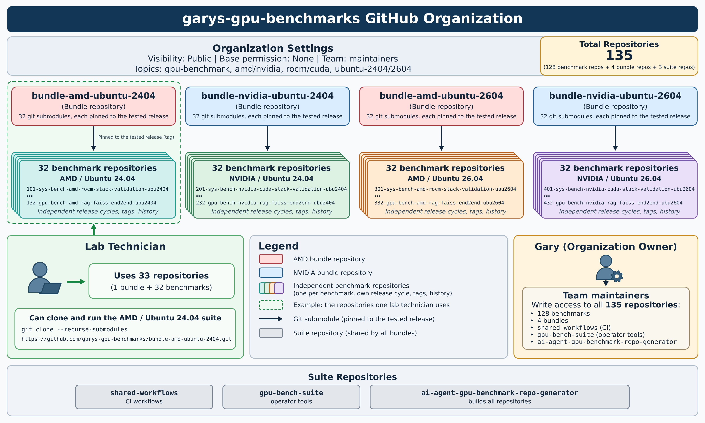

# GPU Benchmark & Platform Validation Workloads

- A standardized collection of 32 hardware, compute, and AI inference validation workloads.
- Run on AMD (ROCm) and NVIDIA (CUDA) accelerators under Ubuntu 24.04 LTS and Ubuntu 26.04 LTS.
- Four platform bundles (AMD/24.04, AMD/26.04, NVIDIA/24.04, NVIDIA/26.04) yielding 128 workload repositories.
- Downloadable individually or as 32-workload bundles.

---

### Four Platform Bundles

| Suite                       | GPU Platform   | Operating System | Workload Numbers   | Repos |
|-----------------------------|----------------|------------------|----------------|------:|
| **AMD / Ubuntu 24.04**      | AMD ROCm     | Ubuntu 24.04     | 101–132        |    32 |
| **NVIDIA / Ubuntu 24.04**   | NVIDIA CUDA  | Ubuntu 24.04     | 201–232        |    32 |
| **AMD / Ubuntu 26.04**      | AMD ROCm     | Ubuntu 26.04     | 301–332        |    32 |
| **NVIDIA / Ubuntu 26.04**   | NVIDIA CUDA  | Ubuntu 26.04     | 401–432        |    32 |

**128 total repositories** (32 unique workloads × 4 platforms)

---

<a href="images/github-organization.png">
  
</a>

---

## 📊 Workload Repository Matrix

| Index | Workload Description | AMD (Ubuntu 24.04) | NVIDIA (Ubuntu 24.04) | AMD (Ubuntu 26.04) | NVIDIA (Ubuntu 26.04) |
| :-: | :--- | :---: | :---: | :---: | :---: |
| **01** | System Config Verification | [101](https://github.com/garys-gpu-benchmarks/101-sys-bench-amd-rocm-stack-validation-ubu2404) | [201](https://github.com/garys-gpu-benchmarks/201-sys-bench-nvidia-cuda-stack-validation-ubu2404) | [301](https://github.com/garys-gpu-benchmarks/301-sys-bench-amd-rocm-stack-validation-ubu2604) | [401](https://github.com/garys-gpu-benchmarks/401-sys-bench-nvidia-cuda-stack-validation-ubu2604) |
| **02** | System Validation (Clocks, Temp, Health) | [102](https://github.com/garys-gpu-benchmarks/102-sys-bench-amd-rocm-health-validation-ubu2404) | [202](https://github.com/garys-gpu-benchmarks/202-sys-bench-nvidia-gpu-health-validation-ubu2404) | [302](https://github.com/garys-gpu-benchmarks/302-sys-bench-amd-rocm-health-validation-ubu2604) | [402](https://github.com/garys-gpu-benchmarks/402-sys-bench-nvidia-gpu-health-validation-ubu2604) |
| **03** | CPU + System Stress Stability | [103](https://github.com/garys-gpu-benchmarks/103-sys-bench-amd-system-stress-stability-ubu2404) | [203](https://github.com/garys-gpu-benchmarks/203-sys-bench-nvidia-system-stress-stability-ubu2404) | [303](https://github.com/garys-gpu-benchmarks/303-sys-bench-amd-system-stress-stability-ubu2604) | [403](https://github.com/garys-gpu-benchmarks/403-sys-bench-nvidia-system-stress-stability-ubu2604) |
| **04** | Silent Data Corruption (SDC / ECC) | [104](https://github.com/garys-gpu-benchmarks/104-gpu-bench-amd-sdc-ecc-integrity-ubu2404) | [204](https://github.com/garys-gpu-benchmarks/204-gpu-bench-nvidia-sdc-ecc-integrity-ubu2404) | [304](https://github.com/garys-gpu-benchmarks/304-gpu-bench-amd-sdc-ecc-integrity-ubu2604) | [404](https://github.com/garys-gpu-benchmarks/404-gpu-bench-nvidia-sdc-ecc-integrity-ubu2604) |
| **05** | PyTorch Tensor Op Correctness Suite | [105](https://github.com/garys-gpu-benchmarks/105-gpu-bench-amd-pytorch-tensor-correctness-ubu2404) | [205](https://github.com/garys-gpu-benchmarks/205-gpu-bench-nvidia-pytorch-tensor-correctness-ubu2404) | [305](https://github.com/garys-gpu-benchmarks/305-gpu-bench-amd-pytorch-tensor-correctness-ubu2604) | [405](https://github.com/garys-gpu-benchmarks/405-gpu-bench-nvidia-pytorch-tensor-correctness-ubu2604) |
| **06** | FIO NVMe Storage Sweep | [106](https://github.com/garys-gpu-benchmarks/106-sys-bench-amd-fio-nvme-sweep-ubu2404) | [206](https://github.com/garys-gpu-benchmarks/206-sys-bench-nvidia-fio-nvme-sweep-ubu2404) | [306](https://github.com/garys-gpu-benchmarks/306-sys-bench-amd-fio-nvme-sweep-ubu2604) | [406](https://github.com/garys-gpu-benchmarks/406-sys-bench-nvidia-fio-nvme-sweep-ubu2604) |
| **07** | STREAM CPU DDR5 Bandwidth | [107](https://github.com/garys-gpu-benchmarks/107-sys-bench-amd-stream-ddr5-bandwidth-ubu2404) | [207](https://github.com/garys-gpu-benchmarks/207-sys-bench-nvidia-stream-ddr5-bandwidth-ubu2404) | [307](https://github.com/garys-gpu-benchmarks/307-sys-bench-amd-stream-ddr5-bandwidth-ubu2604) | [407](https://github.com/garys-gpu-benchmarks/407-sys-bench-nvidia-stream-ddr5-bandwidth-ubu2604) |
| **08** | iPerf3 Network Performance Sweep | [108](https://github.com/garys-gpu-benchmarks/108-sys-bench-amd-iperf3-network-performance-ubu2404) | [208](https://github.com/garys-gpu-benchmarks/208-sys-bench-nvidia-iperf3-network-performance-ubu2404) | [308](https://github.com/garys-gpu-benchmarks/308-sys-bench-amd-iperf3-network-performance-ubu2604) | [408](https://github.com/garys-gpu-benchmarks/408-sys-bench-nvidia-iperf3-network-performance-ubu2604) |
| **09** | multichase NUMA Latency (Pointer-Chase) | [109](https://github.com/garys-gpu-benchmarks/109-sys-bench-amd-multichase-numa-latency-ubu2404) | [209](https://github.com/garys-gpu-benchmarks/209-sys-bench-nvidia-multichase-numa-latency-ubu2404) | [309](https://github.com/garys-gpu-benchmarks/309-sys-bench-amd-multichase-numa-latency-ubu2604) | [409](https://github.com/garys-gpu-benchmarks/409-sys-bench-nvidia-multichase-numa-latency-ubu2604) |
| **10** | NUMA Cache Latency Sweep | [110](https://github.com/garys-gpu-benchmarks/110-sys-bench-amd-numa-cache-performance-ubu2404) | [210](https://github.com/garys-gpu-benchmarks/210-sys-bench-nvidia-numa-cache-performance-ubu2404) | [310](https://github.com/garys-gpu-benchmarks/310-sys-bench-amd-numa-cache-performance-ubu2604) | [410](https://github.com/garys-gpu-benchmarks/410-sys-bench-nvidia-numa-cache-performance-ubu2604) |
| **11** | Linux perf PMU Analysis Harness | [111](https://github.com/garys-gpu-benchmarks/111-sys-bench-amd-linux-perf-pmu-ubu2404) | [211](https://github.com/garys-gpu-benchmarks/211-sys-bench-nvidia-linux-perf-pmu-ubu2404) | [311](https://github.com/garys-gpu-benchmarks/311-sys-bench-amd-linux-perf-pmu-ubu2604) | [411](https://github.com/garys-gpu-benchmarks/411-sys-bench-nvidia-linux-perf-pmu-ubu2604) |
| **12** | lmbench OS Microbench Suite | [112](https://github.com/garys-gpu-benchmarks/112-sys-bench-amd-lmbench-microbench-suite-ubu2404) | [212](https://github.com/garys-gpu-benchmarks/212-sys-bench-nvidia-lmbench-microbench-suite-ubu2404) | [312](https://github.com/garys-gpu-benchmarks/312-sys-bench-amd-lmbench-microbench-suite-ubu2604) | [412](https://github.com/garys-gpu-benchmarks/412-sys-bench-nvidia-lmbench-microbench-suite-ubu2604) |
| **13** | GUPS Random Memory Access | [113](https://github.com/garys-gpu-benchmarks/113-sys-bench-amd-gups-random-memory-ubu2404) | [213](https://github.com/garys-gpu-benchmarks/213-sys-bench-nvidia-gups-random-memory-ubu2404) | [313](https://github.com/garys-gpu-benchmarks/313-sys-bench-amd-gups-random-memory-ubu2604) | [413](https://github.com/garys-gpu-benchmarks/413-sys-bench-nvidia-gups-random-memory-ubu2604) |
| **14** | Host/Device Memcpy (H2D, D2H, D2D) | [114](https://github.com/garys-gpu-benchmarks/114-gpu-bench-amd-hipmemcpy-transfer-bandwidth-ubu2404) | [214](https://github.com/garys-gpu-benchmarks/214-gpu-bench-nvidia-memcpy-transfer-bandwidth-ubu2404) | [314](https://github.com/garys-gpu-benchmarks/314-gpu-bench-amd-hipmemcpy-transfer-bandwidth-ubu2604) | [414](https://github.com/garys-gpu-benchmarks/414-gpu-bench-nvidia-memcpy-transfer-bandwidth-ubu2604) |
| **15** | BabelStream HBM Bandwidth | [115](https://github.com/garys-gpu-benchmarks/115-gpu-bench-amd-babelstream-hbm-bandwidth-ubu2404) | [215](https://github.com/garys-gpu-benchmarks/215-gpu-bench-nvidia-babelstream-hbm-bandwidth-ubu2404) | [315](https://github.com/garys-gpu-benchmarks/315-gpu-bench-amd-babelstream-hbm-bandwidth-ubu2604) | [415](https://github.com/garys-gpu-benchmarks/415-gpu-bench-nvidia-babelstream-hbm-bandwidth-ubu2604) |
| **16** | Collective Fabric Bandwidth (RCCL / NCCL) | [116](https://github.com/garys-gpu-benchmarks/116-gpu-bench-amd-rccl-bandwidth-test-ubu2404) | [216](https://github.com/garys-gpu-benchmarks/216-gpu-bench-nvidia-nccl-bandwidth-test-ubu2404) | [316](https://github.com/garys-gpu-benchmarks/316-gpu-bench-amd-rccl-bandwidth-test-ubu2604) | [416](https://github.com/garys-gpu-benchmarks/416-gpu-bench-nvidia-nccl-bandwidth-test-ubu2604) |
| **17** | GEMM Microbenchmark (rocBLAS / cuBLAS) | [117](https://github.com/garys-gpu-benchmarks/117-gpu-bench-amd-gemm-rocblas-micro-ubu2404) | [217](https://github.com/garys-gpu-benchmarks/217-gpu-bench-nvidia-gemm-cublas-micro-ubu2404) | [317](https://github.com/garys-gpu-benchmarks/317-gpu-bench-amd-gemm-rocblas-micro-ubu2604) | [417](https://github.com/garys-gpu-benchmarks/417-gpu-bench-nvidia-gemm-cublas-micro-ubu2604) |
| **18** | Convolution Solver (MIOpen / cuDNN) | [118](https://github.com/garys-gpu-benchmarks/118-gpu-bench-amd-miopen-convolution-micro-ubu2404) | [218](https://github.com/garys-gpu-benchmarks/218-gpu-bench-nvidia-cudnn-convolution-micro-ubu2404) | [318](https://github.com/garys-gpu-benchmarks/318-gpu-bench-amd-miopen-convolution-micro-ubu2604) | [418](https://github.com/garys-gpu-benchmarks/418-gpu-bench-nvidia-cudnn-convolution-micro-ubu2604) |
| **19** | PyTorch / TorchBench Microkernel Suite | [119](https://github.com/garys-gpu-benchmarks/119-gpu-bench-amd-torch-micro-suite-ubu2404) | [219](https://github.com/garys-gpu-benchmarks/219-gpu-bench-nvidia-torch-micro-suite-ubu2404) | [319](https://github.com/garys-gpu-benchmarks/319-gpu-bench-amd-torch-micro-suite-ubu2604) | [419](https://github.com/garys-gpu-benchmarks/419-gpu-bench-nvidia-torch-micro-suite-ubu2604) |
| **20** | High Performance Linpack (HPL FP64) | [120](https://github.com/garys-gpu-benchmarks/120-gpu-bench-amd-linpack-rochpl-fp64-ubu2404) | [220](https://github.com/garys-gpu-benchmarks/220-gpu-bench-nvidia-linpack-hpl-fp64-ubu2404) | [320](https://github.com/garys-gpu-benchmarks/320-gpu-bench-amd-linpack-rochpl-fp64-ubu2604) | [420](https://github.com/garys-gpu-benchmarks/420-gpu-bench-nvidia-linpack-hpl-fp64-ubu2604) |
| **21** | ResNet-50 FP16 Training Step | [121](https://github.com/garys-gpu-benchmarks/121-gpu-bench-amd-resnet50-pytorch-training-ubu2404) | [221](https://github.com/garys-gpu-benchmarks/221-gpu-bench-nvidia-resnet50-pytorch-training-ubu2404) | [321](https://github.com/garys-gpu-benchmarks/321-gpu-bench-amd-resnet50-pytorch-training-ubu2604) | [421](https://github.com/garys-gpu-benchmarks/421-gpu-bench-nvidia-resnet50-pytorch-training-ubu2604) |
| **22** | ResNet-50 BF16 Inference Throughput | [122](https://github.com/garys-gpu-benchmarks/122-gpu-bench-amd-resnet50-pytorch-inference-ubu2404) | [222](https://github.com/garys-gpu-benchmarks/222-gpu-bench-nvidia-resnet50-pytorch-inference-ubu2404) | [322](https://github.com/garys-gpu-benchmarks/322-gpu-bench-amd-resnet50-pytorch-inference-ubu2604) | [422](https://github.com/garys-gpu-benchmarks/422-gpu-bench-nvidia-resnet50-pytorch-inference-ubu2604) |
| **23** | BERT Base Inference Sweep | [123](https://github.com/garys-gpu-benchmarks/123-gpu-bench-amd-bert-base-inference-ubu2404) | [223](https://github.com/garys-gpu-benchmarks/223-gpu-bench-nvidia-bert-base-inference-ubu2404) | [323](https://github.com/garys-gpu-benchmarks/323-gpu-bench-amd-bert-base-inference-ubu2604) | [423](https://github.com/garys-gpu-benchmarks/423-gpu-bench-nvidia-bert-base-inference-ubu2604) |
| **24** | Stable Diffusion XL Latency Baseline | [124](https://github.com/garys-gpu-benchmarks/124-gpu-bench-amd-sdxl-diffusers-latency-ubu2404) | [224](https://github.com/garys-gpu-benchmarks/224-gpu-bench-nvidia-sdxl-diffusers-latency-ubu2404) | [324](https://github.com/garys-gpu-benchmarks/324-gpu-bench-amd-sdxl-diffusers-latency-ubu2604) | [424](https://github.com/garys-gpu-benchmarks/424-gpu-bench-nvidia-sdxl-diffusers-latency-ubu2604) |
| **25** | DistilBERT NLP Classification Baseline | [125](https://github.com/garys-gpu-benchmarks/125-gpu-bench-amd-distilbert-hf-classification-ubu2404) | [225](https://github.com/garys-gpu-benchmarks/225-gpu-bench-nvidia-distilbert-hf-classification-ubu2404) | [325](https://github.com/garys-gpu-benchmarks/325-gpu-bench-amd-distilbert-hf-classification-ubu2604) | [425](https://github.com/garys-gpu-benchmarks/425-gpu-bench-nvidia-distilbert-hf-classification-ubu2604) |
| **26** | JAX XLA Transformer Forward Pass | [126](https://github.com/garys-gpu-benchmarks/126-gpu-bench-amd-jax-xla-forwardpass-ubu2404) | [226](https://github.com/garys-gpu-benchmarks/226-gpu-bench-nvidia-jax-xla-forwardpass-ubu2404) | [326](https://github.com/garys-gpu-benchmarks/326-gpu-bench-amd-jax-xla-forwardpass-ubu2604) | [426](https://github.com/garys-gpu-benchmarks/426-gpu-bench-nvidia-jax-xla-forwardpass-ubu2604) |
| **27** | vLLM KV Cache Stress Test | [127](https://github.com/garys-gpu-benchmarks/127-gpu-bench-amd-vllm-kvcache-stress-ubu2404) | [227](https://github.com/garys-gpu-benchmarks/227-gpu-bench-nvidia-vllm-kvcache-stress-ubu2404) | [327](https://github.com/garys-gpu-benchmarks/327-gpu-bench-amd-vllm-kvcache-stress-ubu2604) | [427](https://github.com/garys-gpu-benchmarks/427-gpu-bench-nvidia-vllm-kvcache-stress-ubu2604) |
| **28** | vLLM Throughput & Latency Sweep | [128](https://github.com/garys-gpu-benchmarks/128-gpu-bench-amd-vllm-throughput-latency-ubu2404) | [228](https://github.com/garys-gpu-benchmarks/228-gpu-bench-nvidia-vllm-throughput-latency-ubu2404) | [328](https://github.com/garys-gpu-benchmarks/328-gpu-bench-amd-vllm-throughput-latency-ubu2604) | [428](https://github.com/garys-gpu-benchmarks/428-gpu-bench-nvidia-vllm-throughput-latency-ubu2604) |
| **29** | vLLM Mistral Token Generation | [129](https://github.com/garys-gpu-benchmarks/129-gpu-bench-amd-vllm-mistral-rocm-ubu2404) | [229](https://github.com/garys-gpu-benchmarks/229-gpu-bench-nvidia-vllm-mistral-cuda-ubu2404) | [329](https://github.com/garys-gpu-benchmarks/329-gpu-bench-amd-vllm-mistral-rocm-ubu2604) | [429](https://github.com/garys-gpu-benchmarks/429-gpu-bench-nvidia-vllm-mistral-cuda-ubu2604) |
| **30** | SGLang Prompt-Response Benchmark | [130](https://github.com/garys-gpu-benchmarks/130-gpu-bench-amd-sglang-prompt-response-ubu2404) | [230](https://github.com/garys-gpu-benchmarks/230-gpu-bench-nvidia-sglang-prompt-response-ubu2404) | [330](https://github.com/garys-gpu-benchmarks/330-gpu-bench-amd-sglang-prompt-response-ubu2604) | [430](https://github.com/garys-gpu-benchmarks/430-gpu-bench-nvidia-sglang-prompt-response-ubu2604) |
| **31** | SGLang Serving Latency Benchmark | [131](https://github.com/garys-gpu-benchmarks/131-gpu-bench-amd-sglang-serving-latency-ubu2404) | [231](https://github.com/garys-gpu-benchmarks/231-gpu-bench-nvidia-sglang-serving-latency-ubu2404) | [331](https://github.com/garys-gpu-benchmarks/331-gpu-bench-amd-sglang-serving-latency-ubu2604) | [431](https://github.com/garys-gpu-benchmarks/431-gpu-bench-nvidia-sglang-serving-latency-ubu2604) |
| **32** | End-to-End FAISS RAG Pipeline | [132](https://github.com/garys-gpu-benchmarks/132-gpu-bench-amd-rag-faiss-end2end-ubu2404) | [232](https://github.com/garys-gpu-benchmarks/232-gpu-bench-nvidia-rag-faiss-end2end-ubu2404) | [332](https://github.com/garys-gpu-benchmarks/332-gpu-bench-amd-rag-faiss-end2end-ubu2604) | [432](https://github.com/garys-gpu-benchmarks/432-gpu-bench-nvidia-rag-faiss-end2end-ubu2604) |

---

## Execution Mode

| Profile | Typical Runtime | Purpose |
|---|---:|---|
| **Smoke** | ≤ 1 minute | Installation and functionality validation (default), initial run will be longer if setup.sh not yet run |
| **Baseline** | 3–5 minutes | Standard benchmark execution |
| **Extended** | 8–15 minutes | Longer performance characterization |

---
### Benchmark Spec Definitions (Master Blueprint for Every Repository)

[Download BenchmarkSpecDefinitions.xlsx](https://github.com/garymichaelbass/garymichaelbass/raw/refs/heads/main/BenchmarkSpecDefinitions.xlsx)

Download and open the Excel workbook to review workload definitions,
validation objectives, metrics, and execution parameters.

---
### System Requirements

- **OS:** a server running Ubuntu 24.04 LTS or 26.04 LTS, with root or sudo access
- **AMD:** one MI300X GPU (gfx942); `setup.sh` installs ROCm (10.1.0)
- **NVIDIA:** one H100 GPU (sm_90); `setup.sh` installs CUDA (13.3)
- **Host:** 20+ vCPUs, 128+ GB RAM, and about 500 GB of local disk
- **Network:** Internet access for packages and model downloads (1 Gbit/s recommended; 250 Mbit/s minimum)

No server? See [Getting started on AMD Developer Cloud](https://github.com/garys-gpu-benchmarks/ai-agent-gpu-benchmark-repo-generator/blob/main/docs/amd-developer-cloud-getting-started.md) or [Getting started on Runpod](https://github.com/garys-gpu-benchmarks/ai-agent-gpu-benchmark-repo-generator/blob/main/docs/runpod-getting-started.md).

<br>

---
---
### Run a Single Test (Example: Workload 107)
Download, install, and run an individual benchmark repository (Workload 107 - AMD Ubuntu 24.04):

NOTE: Each workload is its own repository named `<number>-<name>`. Find yours in the
[Workload Repository Matrix](#-workload-repository-matrix) above, then clone it:

```bash
apt install git -y
git clone https://github.com/garys-gpu-benchmarks/107-sys-bench-amd-stream-ddr5-bandwidth-ubu2404.git
cd 107-sys-bench-amd-stream-ddr5-bandwidth-ubu2404
bash run_benchmark.sh --help   # Shows help
bash run_benchmark.sh --smoke  # Performs initial setup then runs benchmark (smoke test)
```

Inspect run results:

```bash
ls -a results/raw/*/*                   # List results directory
cat results/raw/*/metrics_summary.txt   # Display metrics stored in file
bash run_benchmark.sh --smoke           # Run the test a second time to generate additional results
bash run_benchmark.sh --smoke           # Run the test a third time to generate additional results
bash show_metrics.sh 107                # Show metrics for 107 (three passes)
bash list_runs.sh                       # List every run on the server via `/var/opt/benchmarks/runtime_ledger.csv` 
```

---
### Operator Tools (collect results to your laptop)

Download the tools with Git (Git Bash works on Windows; assumes SSH to VM on port 22):

```bash
git clone https://github.com/garys-gpu-benchmarks/gpu-bench-suite.git ~/gpu-bench-suite  
cd ~/gpu-bench-suite                                  

bash show_metrics.sh --host <server-address> 107       # Show metrics for 107 on remote server
bash list_runs.sh --host <server-address>              # List every run on the remote server
bash get_benchmark_results.sh --host <server-address>  # Copy results, ledger, and logs from remote server
```

Add `--port N` if SSH is not on port 22 (ie, using Runpod). Run `git pull` in that folder to update the tools.

Or download one file at a time (right-click → Save link as):
[show_metrics.sh](https://github.com/garys-gpu-benchmarks/gpu-bench-suite/raw/main/show_metrics.sh) ·
[list_runs.sh](https://github.com/garys-gpu-benchmarks/gpu-bench-suite/raw/main/list_runs.sh) ·
[get_benchmark_results.sh](https://github.com/garys-gpu-benchmarks/gpu-bench-suite/raw/main/get_benchmark_results.sh)

**Congratulations. You've executed your first workload!**`+

<br>
---
### Run a Full Test Suite (32 workloads)

**1. Pick the bundle for your machine** (you chose the GPU and Ubuntu version when you created it).

<details>
<summary>Not sure? Run this on the GPU host to print the bundle name</summary>

```bash
. /etc/os-release; lspci | grep -qi nvidia && v=nvidia || v=amd; echo "bundle-$v-ubuntu-${VERSION_ID/./}"
```
</details>

| Your machine | Bundle | Workloads |
|---|---|---|
| AMD · Ubuntu 24.04 | `bundle-amd-ubuntu-2404` | 101–132 |
| NVIDIA · Ubuntu 24.04 | `bundle-nvidia-ubuntu-2404` | 201–232 |
| AMD · Ubuntu 26.04 | `bundle-amd-ubuntu-2604` | 301–332 |
| NVIDIA · Ubuntu 26.04 | `bundle-nvidia-ubuntu-2604` | 401–432 |

**2. Download it and check it** (as root; AMD · Ubuntu 24.04 shown, replace the bundle name for yours):

> Use `git clone --recurse-submodules` exactly as shown. Each workload folder is a link to its own
> repository; GitHub's **Download ZIP** does not follow those links and leaves the folders empty.

```bash
git clone --recurse-submodules https://github.com/garys-gpu-benchmarks/bundle-amd-ubuntu-2404 /opt/benchmarks
cd /opt/benchmarks
bash run_benchmark_suite.sh --list        # every workload should say "ready"
```

**3. Run the smoke test for all 32 workloads**

```bash
cd /opt/benchmarks
bash run_benchmark_suite.sh --smoke
```

The first run installs everything (ROCm or CUDA and each workload's software) and can take 75 minutes
or more. **AMD machines may restart once** while installing ROCm: wait a few minutes, log back in, and
run both commands above again; finished workloads are quick the second time. Later runs take about
20 minutes.

**Congratulations. You've run an entire bundle of 32 workloads!**

<br>

---
### After the install

All commands run from `/opt/benchmarks`. Each command prints full usage with `--help`. NOTE: This uses `run_benchmark_suite.sh`, not `run_benchmark.sh`.

| Task | Command |
|---|---|
| Smoke test every workload (installs each on first use) | `bash run_benchmark_suite.sh --smoke` |
| Run one workload, baseline profile (example: 107) | `bash run_benchmark_suite.sh -w 107 --baseline` |
| Run a range of workloads | `bash run_benchmark_suite.sh -w 101-110 --smoke` |
| Run all three profiles (many hours) | `tmux new -s bench`, then `bash run_benchmark_suite.sh --smoke --baseline --extended` |
| Execute a soak test: smoke profile, 20 times | `bash run_benchmark_suite.sh --smoke --repeat 20` |
| Preview what would run | `bash run_benchmark_suite.sh --dry-run` |
| Update to the newest release | `git pull && git submodule update --init --recursive` |

- The suite's own logs go to `/opt/benchmarks/benchmark_suite_log/`, and the suite ends with a pass/fail summary.
- Each workload run gets its own folder, `<workload>/results/raw/<timestamp>_WORKLOAD-<NNN>_SYSTEM-<host>/`, holding that run's `run.log`, raw output, parsed results, and system info.
- Every run is also recorded as one line in the runtime ledger, `/var/opt/benchmarks/runtime_ledger.csv` (view it with `bash list_runs.sh`).
- Inside `tmux`, detach with **Ctrl+B** then **D**; reattach with `tmux attach -t bench`.

For additional tools, reference the [Operator Tools (collect results to your laptop)](#Operator-Tools) section above

---

## Benchmark Categories

The workload suites cover seven primary areas:

- **Memory, Bandwidth & Data Movement** — HBM, fabric, host/device transfers, cache, and bandwidth stress
- **AI Training & Inference** — CNN, Transformer, diffusion, and JAX model training and inference
- **Compute & Math Kernels** — BLAS, LINPACK, microbenchmarks, and mathematical compute kernels
- **LLM Inference & Serving** — vLLM throughput and latency, KV cache, token generation, and SGLang serving
- **System Validation & Reliability** — correctness testing and hardware/software health validation
- **System Profiling & Performance Analysis** — telemetry, counters, and timing characterization
- **End-to-End Application Pipelines** — full-stack application paths such as FAISS-based RAG

---

## Repository Layout & Execution Model

Every one of the 128 repositories follows the same structure, so once you have run one, you know how to run all of them:

```text
<NNN>-<repo>/
├── setup.sh              # installs the ROCm/CUDA + Python stack (run_benchmark.sh calls it on first use)
├── run_benchmark.sh      # bash run_benchmark.sh --smoke|--baseline|--extended
├── show_metrics.sh       # bash show_metrics.sh NNN: this workload's runs from the ledger
├── list_runs.sh          # bash list_runs.sh --host <server-address>
├── config/               # benchmark_config.yaml, hardware profiles
├── scripts/              # parse_results.py, validate_results.py, ...
└── results/
    ├── raw/              # per-run logs, metrics, artifacts
    ├── parsed/           # SQLite + CSV
    ├── benchmark.db      # all runs (SQLite)
    └── summary.json      # latest run summary
```

---

## How These Repositories Are Built

Every repository in this matrix is generated, not hand-written, by
[`ai-agent-gpu-benchmark-repo-generator`](https://github.com/garys-gpu-benchmarks/ai-agent-gpu-benchmark-repo-generator) —
a spec-driven framework that turns one row of a workload spreadsheet into a
complete, execution-ready benchmark repo: setup script, README, PRD/SPEC,
CI workflows, parsing/validation logic, and a smoke test, with zero manual
scaffolding. The next section shows how to generate your own.
<br>
---
---
### Generate Your Own Test Suite (Example: AMD+Ubuntu_24.04)
Create the 32 repositories in the AMD+Ubuntu_24.04 bundle (workloads 101–132) using the AI Coding Agent Specification Drive GPU Benchmark Repository Generator (ai-agent-gpu-benchmark-repo-generator). An AI coding agent builds each repository on your computer, installs it on your GPU server, and runs its smoke test there before moving on to the next one.

**What you need**

- **A GPU server that matches the bundle.** For 101–132: an AMD MI300X running Ubuntu 24.04 plus 20+ vCPUs, 128+ GB RAM, about 500 GB of local disk, and Internet access. For the other bundles, see [Four Platform Bundles](#four-platform-bundles) and [System Requirements](#system-requirements). A freshly installed server works best. No server? See [Getting started on AMD Developer Cloud](https://github.com/garys-gpu-benchmarks/ai-agent-gpu-benchmark-repo-generator/blob/main/docs/amd-developer-cloud-getting-started.md) or [Getting started on Runpod](https://github.com/garys-gpu-benchmarks/ai-agent-gpu-benchmark-repo-generator/blob/main/docs/runpod-getting-started.md).
- **SSH key access to that server** as root.
- **An AI coding agent:** Cursor, or another one such as Claude Code or GitHub Copilot.
- **Git and Python 3.12 or newer** on your computer. On Windows, install [Git for Windows](https://gitforwindows.org/), which includes Git Bash; the generator runs its commands in Git Bash.

**1. Check that you can log in to the server**

```bash
ssh -i /path/to/.ssh/<your-key> root@<server-address>     # Windows example: /c/Users/<you>/.ssh/<your-key>
```

You should get a root prompt without typing a password, and the login banner should show Ubuntu 24.04. Add `-p <port>` if SSH is not on port 22 (Runpod usually needs this). Type `exit` to log out.

**2. Create a workspace and download the generator**

```bash
mkdir -p ~/gpu-bench/workspace
cd ~/gpu-bench/workspace
git clone https://github.com/garys-gpu-benchmarks/ai-agent-gpu-benchmark-repo-generator.git
pip install jsonschema openpyxl PyYAML
```

The generated repositories are written in `workspace/`, next to the generator folder. Use a dedicated folder like this one; the generator also copies its operator tools to the folder above it (`~/gpu-bench/`).

**3. Open the workspace in your AI coding agent**

In Cursor, choose **File → Open Folder** and open `workspace`: the folder that *contains* `ai-agent-gpu-benchmark-repo-generator`, not the generator folder itself. Use Agent mode. On Windows, make Git Bash Cursor's default terminal.

**4. AI coding agent**

The generator is model-agnostic. Generation is driven by scripts and by written rules
(`AGENTS.md`, `docs/AI_AGENT_INSTRUCTIONS.md`), so the agent launches and supervises
the batch rather than writing benchmark code from scratch. Each agent below has
generated a complete batch of 32 workload repositories that passed setup and smoke
validation on real GPU hardware.

| AI coding agent   | Used in           | Last validated batch      |
|-------------------|-------------------|---------------------------|
| Grok 4.7          | Cursor            | November 2026             |
| Claude Sonnet 5.5 | Cursor            | November 2026             |
| Claude Opus 5.5   | Claude / Cursor   | November 2026             |
| GPT-5.6           | Cursor            | November 2026             |


**5. Submit the prompt**

Replace the key path and server address with your own, and keep the backquotes around the `ssh` command:

```text
@ai-agent-gpu-benchmark-repo-generator/docs/AI_AGENT_INSTRUCTIONS.md
Generate workloads 101 through 132.
Remotely access Ubuntu VM with `ssh -i /path/to/.ssh/<your-key> root@<server-address>`
```

- For another bundle, change the range and use a matching server: `201 through 232` (NVIDIA, Ubuntu 24.04), `301 through 332` (AMD, Ubuntu 26.04), or `401 through 432` (NVIDIA, Ubuntu 26.04).
- To try a single workload first, use `Generate workload 107.`; lists such as `Generate workloads 107, 115.` also work.

**6. Let it run**

Generating all 32 typically takes 90 minutes or longer. The agent works through the workloads one at a time and keeps going until every one is done or recorded as failed. It runs on your computer, so keep the computer awake and online until it finishes.

**What you get**

- **32 repositories** in `workspace/`, `101-sys-bench-amd-rocm-stack-validation-ubu2404/` through `132-gpu-bench-amd-rag-faiss-end2end-ubu2404/`, each laid out as shown in [Repository Layout & Execution Model](#repository-layout--execution-model).
- **A ready server.** Each workload is installed and smoke-tested in `/opt/benchmarks/<repo>`, and the suite tools are in `/opt/benchmarks`, so the commands in [After the install](#after-the-install) work there right away.
- **The operator tools** (`list_runs.sh`, `show_metrics.sh`, `get_benchmark_results.sh`) in `~/gpu-bench/`, ready to use as in [Operator Tools](#operator-tools-collect-results-to-your-laptop). The master copies of all the user scripts are in `ai-agent-gpu-benchmark-repo-generator/user_scripts/`.
- **A record of the run** in `workspace/`: the prompt you submitted (`AI_AGENT_PROMPT_SUBMITTED_*.md`) and `batch_generation_manifest.json`, which lists each workload's result and generation time.

To change what gets generated (parameters, metrics, success criteria), edit `ai-agent-gpu-benchmark-repo-generator/BenchmarkSpecDefinitions.xlsx` before you submit the prompt.

**Congratulations. You've created 32 workloads!**

